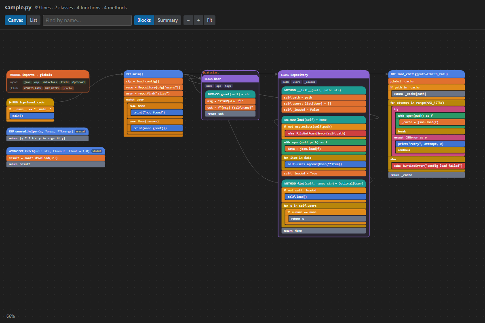

# Python Block Preview

Python 코드를 에디터 옆에 블록 코딩 화면처럼 보여주는 VS Code 확장입니다. 함수는 블록 묶음, `if`/`for`/`try`는 C자형 블록, 함수 사이의 호출은 화살표로 그려지며, 코드를 고치면 바로 반영됩니다.

[English README](README.md)

## 기능

- **블록 캔버스**: 함수마다 블록 묶음이 2D 작업 화면에 배치됩니다. 실행 시작점은 왼쪽, 그 함수가 부르는 함수는 오른쪽으로 이어지고, 처음 열면 파일 전체가 한 화면에 들어옵니다.
- **호출 화살표**: 같은 파일 안의 호출 관계를 화살표로 표시합니다. 블록에 마우스를 올리거나 선택하면 그 함수와 연결된 화살표만 강조됩니다.
- **요약 모드**: 함수를 시그니처와 호출 관계만 남기고 접습니다. 큰 파일은 자동으로 요약 모드로 열립니다.
- **상세 패널**: 함수를 클릭하면 호출하는 것, 호출하는 곳, 반환값, 예외, 지역 변수, 읽고 쓰는 전역 변수를 보여줍니다.
- **검토 힌트**: 파일 안에서 아무도 부르지 않는 함수에 *미사용* 표시, 전역 변수 쓰기와 예외 강조
- **양방향 이동**: 커서 위치의 블록이 강조되고, 블록을 클릭하면 해당 코드 줄로 이동합니다.
- **입력 중인 코드도 OK**: 문법 오류는 그 함수에만 표시되고 나머지 화면은 유지됩니다.
- **목록 보기**: 위에서 아래로 읽는 카드 목록도 버튼 하나로 전환됩니다.
- **Python 설치 불필요**: [tree-sitter](https://tree-sitter.github.io/)로 확장 안에서 파싱하며 코드를 실행하지 않습니다.

## 설치

1. [최신 릴리스](https://github.com/doyeonryu/py-block-preview/releases/latest)에서 `py-block-preview-<버전>.vsix`를 받습니다.
2. VS Code 확장 탭 → `…` → **VSIX에서 설치…** 로 파일을 선택합니다.
   또는 터미널에서 `code --install-extension py-block-preview-<버전>.vsix`

VS Code 1.90 이상, 그리고 `.vsix` 설치를 지원하는 Cursor, Windsurf, VSCodium에서 동작합니다. 내 PC에 한 번만 설치하면 WSL, SSH, Dev Container 원격 창에서도 그대로 쓸 수 있습니다.

## 사용법

Python 파일을 열고 에디터 오른쪽 위 **Block Preview** 아이콘을 누르거나 <kbd>Ctrl</kbd>+<kbd>Alt</kbd>+<kbd>P</kbd>를 누릅니다. 한 번 더 누르면 닫힙니다.

| 동작               | 방법                                                             |
| ------------------ | ---------------------------------------------------------------- |
| 화면 이동          | 배경 드래그 또는 스크롤                                          |
| 확대/축소          | <kbd>Ctrl</kbd>+스크롤, `−` `+` 버튼                        |
| 전체 보기          | **Fit**                                                          |
| 블록 ↔ 요약        | **Blocks** / **Summary**                                         |
| 캔버스 ↔ 목록      | **Canvas** / **List**                                            |
| 코드로 이동        | 블록 클릭                                                        |
| 호출된 함수로 이동 | 파란 호출 칩 클릭 (<kbd>Ctrl</kbd>+클릭은 호출 위치 코드로 이동) |
| 함수 찾기          | 검색창에 입력, <kbd>Enter</kbd>로 첫 결과로 이동                 |

## 한계

- 호출 관계는 **파일 하나 안에서만** 연결합니다. import한 함수는 외부 호출로 표시됩니다.
- 타입 추론은 단순한 패턴만 다룹니다 (`x = 클래스(...)`, 타입 힌트, 반환 타입 힌트).

## 기여 · 라이선스

[CONTRIBUTING.md](CONTRIBUTING.md) 참고. 라이선스는 [MIT](LICENSE)입니다.
