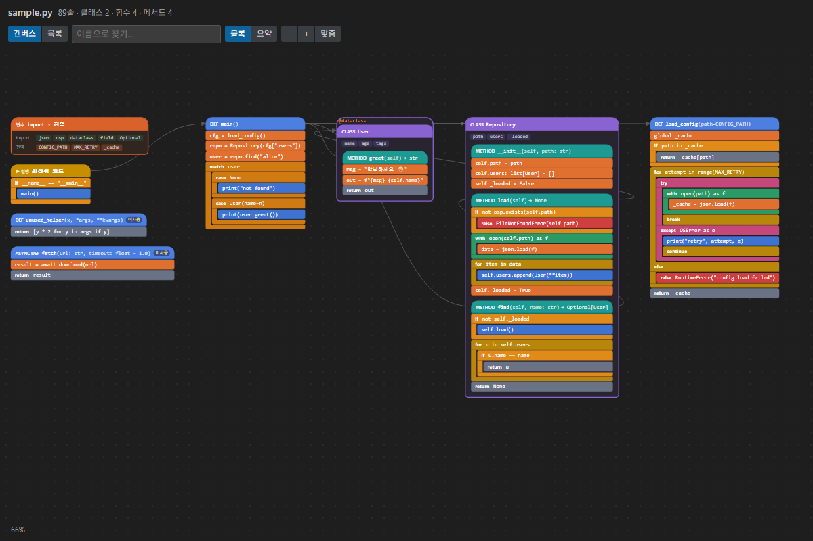
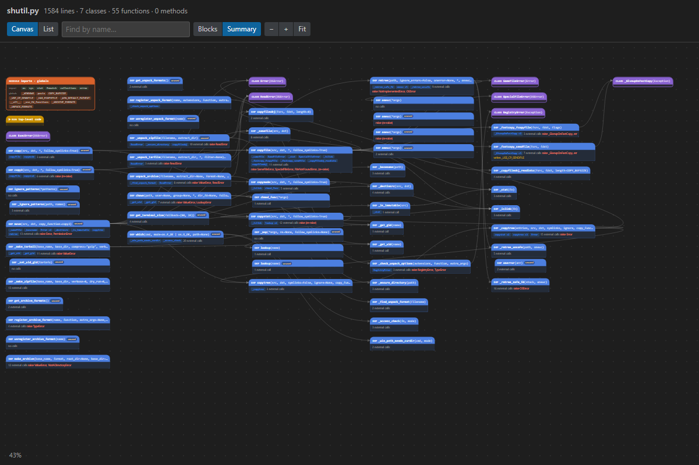
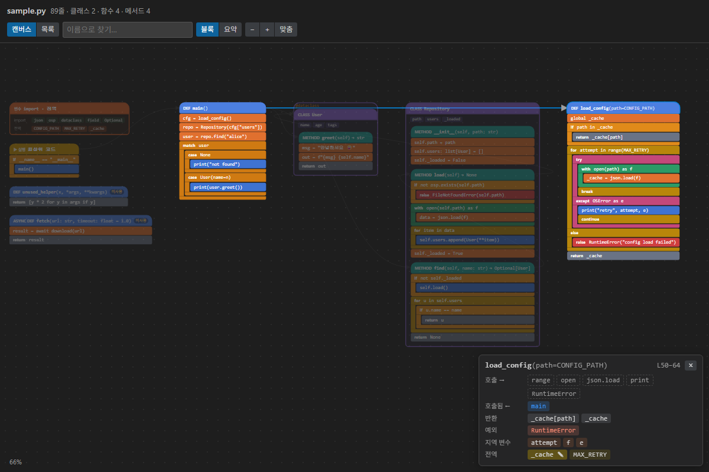

# Python Block Preview

A VS Code extension that shows Python code as a block-coding view beside the editor. Functions are block stacks, `if`/`for`/`try` are C-shaped blocks, calls between functions are arrows, and the view updates as you edit.

[한국어 README](README.ko.md)

## Features

- **Block canvas.** Each function becomes a block stack on a pannable, zoomable workspace. Entry points sit on the left; the functions they call flow to the right. The whole file fits on screen when it opens.
- **Call arrows.** Calls between functions in the same file are drawn as arrows. Hover or select a block to highlight only its callers and callees.
- **Summary mode for big files.** Collapse each function to its signature and call links. Large files open in summary mode automatically.

  

- **Inspector.** Click a function to see what it calls, who calls it, what it returns, which exceptions it raises, its local variables, and which globals it reads or writes.

  

- **Review hints.** Functions that nothing in the file calls are tagged *unused*; writes to globals and raised exceptions are called out.
- **Two-way navigation.** The block under your cursor is highlighted; clicking a block jumps to that line.
- **Tolerates broken code.** While you type, a syntax error only marks the definition it is in — the rest of the map stays intact.
- **List view.** A compact card list is one click away if you prefer reading top to bottom.
- **No Python required.** Parsing runs inside the extension with [tree-sitter](https://tree-sitter.github.io/); nothing is executed.

## Install

Python Block Preview is distributed through GitHub Releases for now.

1. Download `py-block-preview-<version>.vsix` from the [latest release](https://github.com/doyeonryu/py-block-preview/releases/latest).
2. In VS Code, open the Extensions view, click `…` → **Install from VSIX…**, and pick the file.
   Or from a terminal: `code --install-extension py-block-preview-<version>.vsix`

Works in VS Code 1.90+ and VS Code–based editors that accept `.vsix` files (Cursor, Windsurf, VSCodium). Install it once on your local machine — it also works in WSL, SSH and Dev Container windows.

## Usage

Open a Python file, then click the preview icon in the editor title bar or press <kbd>Ctrl</kbd>+<kbd>K</kbd> <kbd>B</kbd> (<kbd>Cmd</kbd>+<kbd>K</kbd> <kbd>B</kbd> on macOS). The preview follows whichever Python file is active.

| Action | How |
|---|---|
| Pan | Drag the background, or scroll |
| Zoom | <kbd>Ctrl</kbd>/<kbd>Cmd</kbd> + scroll, or the `−` `+` buttons |
| Fit the whole file | **맞춤** (Fit) |
| Blocks ↔ summary | **블록** / **요약** |
| Canvas ↔ list | **캔버스** / **목록** |
| Go to code | Click a block |
| Go to a called function | Click a blue call chip (<kbd>Ctrl</kbd>/<kbd>Cmd</kbd>+click goes to the call site instead) |
| Find a function | Type in the search box; <kbd>Enter</kbd> jumps to the first match |

## What it understands

| Shown | Details |
|---|---|
| Definitions | functions, `async def`, classes, methods, nested functions, decorators, docstrings |
| Signatures | parameters with types and defaults, return annotations, base classes |
| Calls | resolved within the file for plain calls, `self.method()`, `ClassName.method()`, and variables whose type is known from `x = ClassName(...)`, annotations, or a function's return annotation |
| Control flow | `if`/`elif`/`else`, `for`/`while` (with `else`), `try`/`except`/`else`/`finally`, `with`, `match`/`case`, `return`, `raise`, `yield`, `await`, `break`/`continue` |
| Variables | locals, `global` writes, module globals read, class attributes and `self.x` assignments |

### Limitations

- Calls are resolved **within one file**. Imported functions appear as external calls.
- Type inference is deliberately shallow; dynamic dispatch, `getattr`, and untyped return values are not followed.
- The UI text is currently in Korean. Translations are welcome.

## How it works

The extension parses the active document with tree-sitter (WebAssembly), converts the syntax tree into a small JSON model (definitions, calls, flow, variables), and posts it to a webview that lays out the blocks. See [CONTRIBUTING.md](CONTRIBUTING.md) for the architecture and development setup.

## Contributing

Bug reports, ideas and pull requests are welcome — see [CONTRIBUTING.md](CONTRIBUTING.md).

## License

[MIT](LICENSE). Bundled third-party components are listed in [THIRD_PARTY_NOTICES.md](THIRD_PARTY_NOTICES.md).
